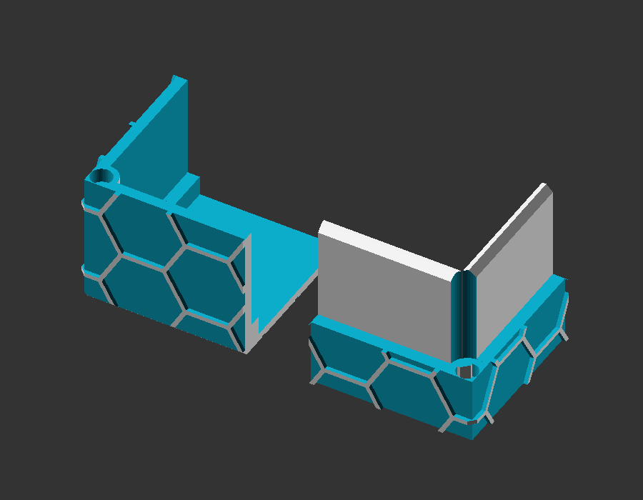
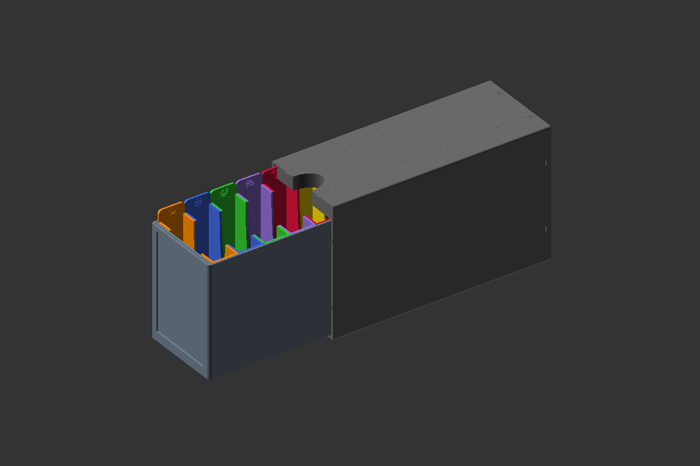

# dummy-box-factory

Parametric 3D-printable deck boxes for *Android: Netrunner* — one per faction,
each only as deep as the deck it holds.

[Dummy Box](https://netrunnerdb.com/en/card/12108) stops the Corp trashing your
installed cards. This one stops your backpack doing the same.


Friction-fit lid, beveled edges, hex-lattice texture, emblem raised on both
faces. Grown out of
[Austin's parametric scifi deck box](https://www.thingiverse.com/thing:39997),
which shipped one fixed size and two emblems.

## Sizes

Cards are all the same shape, so every box is 78 × 100 mm and only the depth
moves.

| Side | Factions | Deck | Box |
|---|---|---|---|
| Runner | Anarch, Criminal, Shaper | 40 + ID | 78 × **35.7** × 100 mm |
| Corp | Haas-Bioroid, Jinteki, NBN, Weyland | 44 + ID | 78 × **38.1** × 100 mm |

Depth is `cards × per-card thickness + 1.5 mm slack + walls`. Sleeves decide the
rest — there's nearly 20 mm between bare and double-sleeved:

| `card_sleeving` | mm/card | 45-card corp box | |
|---|---|---|---|
| `none` | 0.34 | 78 × 26.4 × 100 mm | **measured** |
| `single` *(default)* | 0.6 | 78 × 38.1 × 100 mm | **measured** |
| `double` | 0.72 | 78 × 43.5 × 100 mm | *estimated* |

Measured with a caliper: a bare card is 0.34 mm, and 31 cards in **Dragon
Shield** sleeves came to 18.69 mm. One sleeved card is 66.24 × 92.29 mm. Other
sleeves: stand a known stack on edge, measure it, edit the row.

## Jack in

```bash
nix-shell                    # or: direnv allow
just build                   # all eight plates into files/
just build 50                # ...at 50 cards each
just build-one jinteki 50    # ...or just the one
just sleeving=double build   # ...for double-sleeved decks
just magnets=0 build         # ...with no magnet pockets
just sizes                   # dimensions only, nothing exported
just corner                  # ...just one magnet corner, to test the fit
```

Non-standard builds land in `out/` rather than `files/`; `just clean` bins them.
No nix? Put `openscad` on `$PATH`, or set `OPENSCAD=`.

Each STL is a print plate: box bottom and lid, side by side.

## Printing

**0.4 mm nozzle, 0.2 mm layers, 1 extra shell, 10% infill.**

Walls and floors are multiples of the nozzle width and layer height, so if yours
differ, edit `nozzle_width` / `layer_height` at the top of `src/deckbox.scad` and
re-export. Don't scale the STL.

Layer height is the one that bites: `floor_thickness` is 6 layers and
`sleeve_z_gap` is 4, so slicing at a height that doesn't divide them puts the
floor mid-layer.

### OrcaSlicer

Process panel on the right; both tabs show in Simple mode.

| Tab | Setting | Stock | Set to |
|---|---|---|---|
| Quality | Layer height | 0.2 mm | **0.2 mm** |
| Strength | Wall loops | 2 | **3** |
| Strength | Sparse infill density | 15% | **10%** |

Wall loops 3 *is* the "1 extra shell". Leave the shell layers alone — Orca's
stock 3 + 3 is exactly the 6 layers `floor_thickness` assumes, so floors come
out solid. *(Checked against Orca 2.4.2.)*

### Doesn't fit?

| If | Then |
|---|---|
| Lid too tight or too loose | `sleeve_xy_gap` |
| Your sleeves aren't in the table | `sleeving_table` |
| You want tokens in there too | `extra_card_slots`, ~0.5 mm each |
| You want a different capacity | card counts in `faction_table` |

Every run echoes the resulting cavity and outer size.

## Magnets

**The boxes ship with magnet pockets, sized for 3 × 2 mm discs.** Two per box —
one in the lid, one in the body — at diagonally opposite corners.

3 mm is the largest that fits inside the existing corner, so the outside
doesn't change. They hold roughly 200 g, more than a loaded box weighs; the
sleeve is still the real closure, the magnets just make it click.

Glue them in against the 0.2 mm recess, and **watch the polarity** — one flipped
magnet gives you a lid that pushes itself off. Mark the stack before you start.

No magnets: `just magnets=0 build`, or set `magnet_diameter = 0` in
`src/deckbox.scad` to make it permanent.

### Test the corner first

```bash
just corner            # generic, into out/corner_generic.stl
just corner jinteki    # ...or a specific faction
```



Both halves cropped to one magnet corner, 25 mm along each wall. It tells you
whether the lid seats and the magnets drop in, in minutes instead of hours.
25 mm of sleeve friction is not 78 mm of it, though: judge `sleeve_xy_gap` on a
real box.

### Bigger magnets

Anything over 3 mm needs the corners to grow into posts, which the script works
out and adds by itself:

| Ø | Corner post | Protrudes | ~Hold |
|---|---|---|---|
| 3 mm *(default)* | none | **0 mm** | ~200 g |
| 4 mm | 5.8 mm | 1.75 mm | ~250 g |
| 5 mm | 6.8 mm | 2.75 mm | ~375 g |

Thickness is nearly free — up to about 18 mm before the pocket would break
through the lid's top plate. Diameter is what costs you silhouette.

If the lid ends up too grabby with magnets *and* sleeve friction, loosen
`sleeve_xy_gap` rather than reaching for weaker magnets.

## Organizer

A drawer organizer for a whole card pool: an outer sleeve, a drawer and one
tray per faction. Remixed from the
[Netrunner NSG Organizer](https://makerworld.com/models/2956774), whose fixed
ceiling jams Dragon Shield-sleeved cards; here every height comes from the card.



```bash
just organizer                           # every part, into files/
just tray_set=system_gateway organizer   # 25-card trays, 62-card neutral
just organizer-size                      # dimensions only
```

| Part | Print |
|---|---|
| `organizer_outer` | Standing on its closed end, about 195 mm tall |
| `organizer_drawer` | Upright |
| `organizer_tray_<faction>` | Upright; 30 cards each |
| `organizer_rail` | Flat; two per joint, to join sleeves via their dovetail grooves |

### Other sleeves

The full set is about 19 hours of printing. Measure one sleeved card (height:
longest of ten, across the open end; thickness: 30 on edge, squeezed, ÷ 30),
then export four test pieces into `out/`:

```bash
just card_height=92.29 card_width=66.24 card_thickness=0.6 organizer-tests
```

Print them in order and stop at the first failure:

| Piece | Pass | Else adjust |
|---|---|---|
| `organizer_gauge` | A sleeved card clears its ceiling by about 2 mm | `card_height` |
| `organizer_rail` | Slides into a gauge groove, firm but not forced | `rail_gap` |
| `organizer_tray_jinteki` | 30 cards slide in; walls about 1 mm above them | `tray_stack_slack`, `card_width` |
| `organizer_drawer_slice` | Loaded tray in the drawer passes through the ring without catching | `outer_gap`, `outer_top_gap`, `drawer_tray_gap` |

Then `organizer` with the same values. Custom sizes land in `out/`; to make them
the default, edit `sleeving_table` in `src/organizer.scad`.

## New emblems

Add a row to `faction_table`, then drop the artwork in named for it —
`svg_sources/<faction>.svg` converts to `emblems/<faction>.dxf`, and
`just emblems` picks it up with no further wiring. Hand-trace in Inkscape
([tutorial](http://repraprip.blogspot.com/2011/05/inkscape-to-openscad-dxf-tutorial.html)),
or convert a filled SVG (paths only — `<line>` elements are ignored):

```bash
python3 src/svg2dxf.py src/emblems/svg_sources/mine.svg src/emblems/mine.dxf 76
```

The `76` normalises the longest side, so every faction shares one
`emblem_scale` of 0.7. Check it fits the hex frame — Weyland's W didn't, and
rides at 0.63.

**Then run `just check-emblems`.** Outlines that touch or overlap themselves
extrude into a non-manifold mesh, which CGAL *discards without failing the
render* — that's how two of Austin's prints came out blank. `deckbox.scad`
erode/dilates every emblem (`emblem_cleanup_epsilon`) to head it off.

## Layout

| Path | What |
|---|---|
| `src/deckbox.scad` | The generator, driven by `faction_table` |
| `src/organizer.scad` | The organizer, driven by `sleeving_table` and `tray_table` |
| `src/svg2dxf.py` | Filled SVG → OpenSCAD-importable DXF |
| `src/stl_equal.py` | Compares STLs by geometry, not bytes |
| `src/emblems/` | `<faction>.dxf`, generated from `svg_sources/<faction>.svg` |
| `files/` | Exported print plates |
| `out/` | Custom builds; gitignored |
| `images/renders/` | A render per faction, the corner coupon and the organizer |

`just build` only rewrites plates whose geometry actually changed, so rebuilds
leave the tree clean.

`generic` is an eighth row in `faction_table`: the same box with no emblem, for
anyone who wants the shape without the faction.

## Development

```bash
just hooks-install
just ci
```

[Conventional commits](https://www.conventionalcommits.org/), enforced by
commitizen. Pushes to `main` cut a
[semantic release](https://github.com/go-semantic-release/semantic-release) with
every STL attached.

## Credits

- Design: Thingiverse user **Austin**, [thing:39997](https://www.thingiverse.com/thing:39997) (CC BY-SA)
- Organizer: [Netrunner NSG Organizer](https://makerworld.com/models/2956774) on MakerWorld (CC BY-NC-SA)
- Emblems: [Netrunner-Icon-Font](https://github.com/MWDelaney/Netrunner-Icon-Font) by Michael W. Delaney (MIT)

See [LICENSE](LICENSE). *Android: Netrunner* and the faction logos belong to
their rights holders — print these for your own shelf, not for sale.
