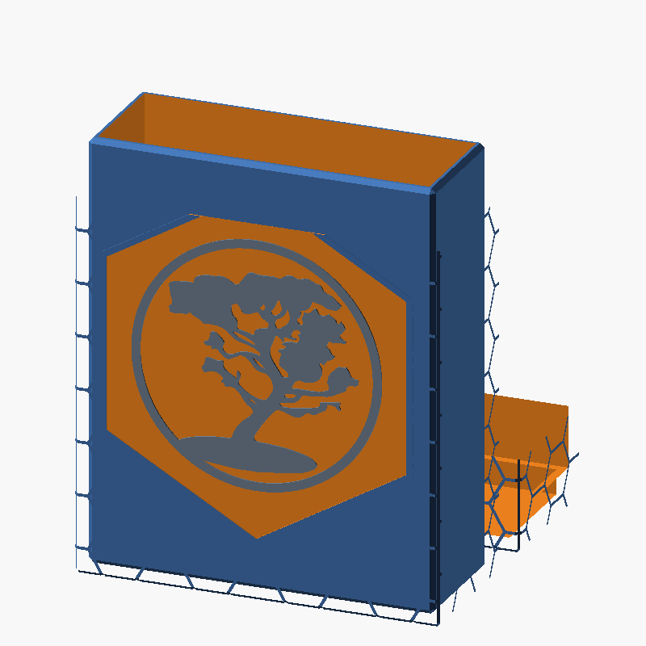

# dummy-box-factory

Parametric 3D-printable deck boxes for *Android: Netrunner* — one per faction,
each only as deep as the deck it has to hold.

Named for [Dummy Box](https://netrunnerdb.com/en/card/12108), the Shaper
resource that stops the Corp trashing your installed cards.

Friction-fit lid, beveled edges, hexagonal lattice texture, and the faction
emblem raised on both the front and the back. Derived from
[Austin's parametric scifi deck box](https://www.thingiverse.com/thing:39997),
which shipped a single fixed size and two emblems.



## What You Get

Card width and length don't change, so every box is 78 × 100 mm on the outside
and only the depth follows the deck.

| Side | Factions | Cards | Outer size |
|---|---|---|---|
| Runner | Anarch, Criminal, Shaper | 40 + ID | 78 × **30.5** × 100 mm |
| Corp | Haas-Bioroid, Jinteki, NBN, Weyland | 44 + ID | 78 × **32.6** × 100 mm |

Depth is `(cards × 0.525 mm) + 1.5 mm slack + walls`. The 0.525 comes from the
original design's own "31.5 mm cavity ≈ 60 cards".

Each STL in `files/` is a print plate: box bottom and lid laid out side by side.

OpenSCAD doesn't emit facets in a stable order, so two exports of an identical
model differ byte-for-byte. `just build` therefore compares geometry via
`src/stl_equal.py` and only rewrites a plate that genuinely changed — rebuilding
leaves the working tree clean.

## Quick Start

```bash
nix-shell                      # or: direnv allow
just build                     # export all seven STLs into files/
just build 50                  # ...all seven at 50 cards instead
just build-one jinteki         # just the one
just build-one jinteki 50      # ...at a custom card count
just sizes                     # every faction's cavity and outer size
just size jinteki 50           # one faction, at a card count, without exporting
```

The card count is a positional argument rather than a `--flag`, because `just`
parses `--options` as its own. Any custom count writes
`files/deckbox_<faction>_<n>cards.stl`, so it never overwrites the committed
standard plates (and it's gitignored).

Without nix, put `openscad` on your PATH (or set `OPENSCAD=/path/to/openscad`)
and the same recipes work.

### Why nix and not hermit

Hermit covers `just`, `prek`, `ruff`, `python3` and `semantic-release`, but it
has no OpenSCAD package — and OpenSCAD is the one dependency this repo can't do
without. Nix has all of it, so the dev shell is `shell.nix`/`flake.nix`. CI
pulls `semantic-release` straight from its GitHub release instead, which keeps
the repo down to a single environment manager.

## Printing

With a **0.4 mm nozzle and 0.27 mm layers**, slice with 1 extra shell and 10%
infill. Every wall and floor thickness is a multiple of those two numbers, so if
yours differ, edit `nozzle_width` and `layer_height` at the top of
`src/deckbox.scad` and re-export rather than scaling the STL.

| If | Then |
|---|---|
| The lid is too tight or too loose | Tune `sleeve_xy_gap` |
| Your sleeves aren't ~0.525 mm/card | Measure a known stack on edge, set `sleeved_card_thickness` |
| You want tokens in the box too | Raise `extra_card_slots` (each slot ≈ 0.5 mm of depth) |
| You want a different capacity | Edit the card counts in `faction_table` |

The script echoes the resulting cavity and outer size on every run.

## Adding a Faction or Emblem

Add a row to `faction_table` in `src/deckbox.scad` and drop a line-segments-only
DXF into `src/emblems/`. Either hand-trace one in Inkscape
([tutorial](http://repraprip.blogspot.com/2011/05/inkscape-to-openscad-dxf-tutorial.html))
or convert a filled SVG:

```bash
python3 src/svg2dxf.py path/to/emblem.svg src/emblems/my_emblem.dxf 76
```

The trailing `76` normalises the drawing's longest side, which is why every
faction shares one `emblem_scale` of 0.7 and needs no per-emblem offset. Check
the result fits its hexagonal frame — Weyland's W didn't, and sits at 0.63.

## Emblems That Vanish

Hand-traced outlines very often contain contours that touch or overlap
themselves. Extruding one produces a non-manifold mesh that CGAL **discards
without failing the render** — which is what made two of the original author's
prints come out blank. `deckbox.scad` runs every emblem through a tiny
erode/dilate pair (`emblem_cleanup_epsilon`) first. Run `just check-emblems` to
verify each one still forms a closed mesh; CI does this too.

The two original hand-traced DXFs hit a related problem: Inkscape wrote a
`SPLINE` entity that modern OpenSCAD can't read, so the Shaper emblem lost its
diamond frame and Haas-Bioroid lost the "H". Both are regenerated from SVG here;
the originals are kept alongside as `*_handtraced_original.dxf` for comparison.

## Layout

| Path | What |
|---|---|
| `src/deckbox.scad` | The generator, driven by `faction_table` |
| `src/svg2dxf.py` | Filled SVG paths → OpenSCAD-importable DXF |
| `src/emblems/` | One DXF per faction, plus the SVG sources |
| `src/deckbox_original.scad` | The unmodified original, for reference |
| `files/` | Exported print plates |
| `images/renders/` | A preview render per faction, plus the emblem-less `generic` |

`files/deckbox_generic.stl` is left exactly as it came from Thingiverse, so it's
still the original 39 mm-deep 60-card box. Build the `generic` faction row for an
emblem-less box at the current corp size.

## Development

```bash
just hooks-install   # run the lint hooks on every commit
just ci              # lint + verify emblems + confirm DXFs match their SVGs
```

Commits follow [conventional commits](https://www.conventionalcommits.org/) —
the commitizen hook enforces it on `commit-msg`. Pushes to `main` run
[go-semantic-release](https://github.com/go-semantic-release/semantic-release),
which tags a version and cuts a GitHub Release with all seven STLs attached, so
people can grab a printable plate without cloning or installing OpenSCAD.

## Credits

- Original design: Thingiverse user **Austin**, [thing:39997](https://www.thingiverse.com/thing:39997) (CC BY-SA)
- Emblem artwork: [Netrunner-Icon-Font](https://github.com/MWDelaney/Netrunner-Icon-Font) by Michael W. Delaney (MIT)

See [LICENSE](LICENSE). *Android: Netrunner* and the faction logos belong to
their respective rights holders.
